# SysML AI Q&A – Benutzerhandbuch

Dieses Handbuch erklärt das Plugin-Fenster nach der Installation: wo jede Einstellung ist, was sie bewirkt und welche Werte für Messungen sinnvoll sind. Installiert wird nach [`INSTALL.md`](INSTALL.md).

> **Zu den Bildern:** Die Fenster-Screenshots zeigen das echte Plugin-Fenster mit einem kleinen Demo-Modell (Roboter mit Batterie, Antrieb, Chassis und drei Anforderungen) und Beispielantworten. In CATIA sieht das Fenster je nach Windows-Design etwas anders aus. Aufbau und Beschriftungen sind gleich.

**Inhalt**

1. [Fenster öffnen](#1-fenster-öffnen)
2. [Das Fenster im Überblick](#2-das-fenster-im-überblick)
3. [Alle Einstellungen erklärt](#3-alle-einstellungen-erklärt)
4. [Eine Frage stellen](#4-eine-frage-stellen)
5. [Die Antwort lesen](#5-die-antwort-lesen)
6. [Fragen zu einem Element](#6-fragen-zu-einem-element)
7. [Schnellfragen](#7-schnellfragen)
8. [Testlauf mit vielen Fragen](#8-testlauf-mit-vielen-fragen)
9. [Ergebnisse finden und bewerten](#9-ergebnisse-finden-und-bewerten)
10. [Empfohlene Einstellungen für Messungen](#10-empfohlene-einstellungen-für-messungen)
11. [Häufige Fragen](#11-häufige-fragen)

---

## 1. Fenster öffnen

| Wo | Menüpunkt | Was die KI bekommt |
| --- | --- | --- |
| Rechtsklick im Containment Tree oder in einem Diagramm | **Ask AI (SysML AI Q&A) → Ask AI about the model…** | das ganze Modell |
| Rechtsklick auf ein Element | **Ask AI (SysML AI Q&A) → Ask AI about this element…** | nur dieses Element mit seiner Umgebung |
| Menüleiste | **Ask AI → Ask AI about the model…** | das ganze Modell |
| Menüleiste, Element vorher markiert (auch in einer Tabelle) | **Ask AI → Ask AI about the selected element…** | nur das markierte Element mit Umgebung |

In einer **Requirement-Tabelle** erscheint beim Rechtsklick kein Eintrag. Dann die Zeile markieren und den Weg über die Menüleiste nehmen.

Beim Öffnen exportiert das Plugin das Modell aus CATIA. Das dauert je nach Modellgröße einige Sekunden. Danach steht unten im Einstellungsbereich **Model ready: …** mit der Anzahl der Elemente und Beziehungen.

---

## 2. Das Fenster im Überblick

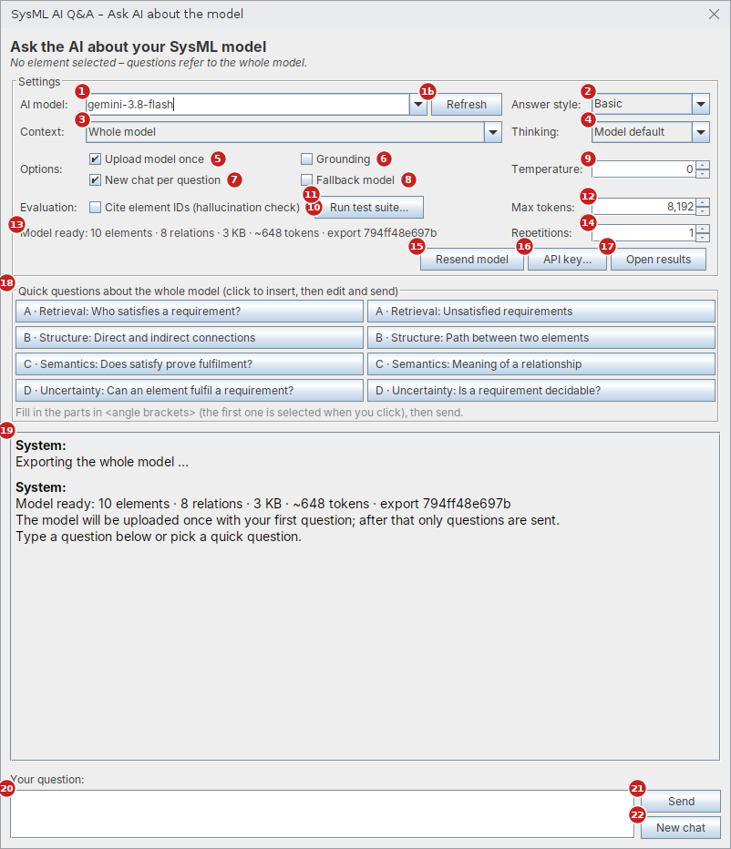

Das Fenster hat vier Bereiche, von oben nach unten:

| Bereich | Nummern | Wozu |
| --- | --- | --- |
| **Settings** | 1–17 | KI-Modell und Versuchsparameter einstellen, Testlauf starten, Ergebnisse öffnen |
| **Quick questions** | 18 | Fragevorlagen zum Anklicken |
| **Chatverlauf** | 19 | Fragen, Antworten und Systemmeldungen |
| **Your question** | 20–22 | Frage eintippen und abschicken |

Alle Einstellungen werden automatisch gespeichert und beim nächsten Öffnen wiederhergestellt. Ausnahme: **Context** richtet sich danach, über welchen Menüpunkt das Fenster geöffnet wurde.

---

## 3. Alle Einstellungen erklärt

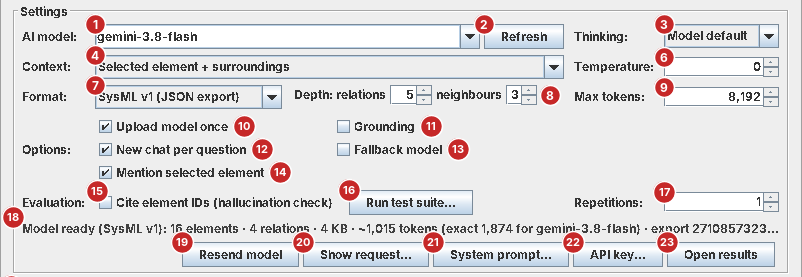

| Nr. | Bedienelement | Was es bewirkt | Standard |
| --- | --- | --- | --- |
| 1 | **AI model** | Welches Gemini-Modell antwortet. Auswählen oder eine Modell-ID eintippen. Vorgeschlagen sind `gemini-3.8-flash`, `gemini-3.6-flash`, `gemini-3.5-flash-lite` und `gemini-3.1-flash-lite` | `gemini-3.8-flash` |
| 1b | **Refresh** | Lädt die Liste aller Modelle, die für deinen API-Key verfügbar sind. Wichtig für den Vergleich verschiedener Modellgrößen | – |
| 2 | **Answer style** | *Basic*: kurz und einfach. *Expert*: ausführlich, nennt die Modellelemente. Ändert den System-Prompt | Basic |
| 3 | **Context** | Welcher Teil des Modells an die KI geht. *Whole model*: alles außer den SysML/UML-Bibliotheken. *Selected element + surroundings*: nur das Element, seine Besitzer, Nachbarn und Beziehungen (kleiner und schneller). Nur verfügbar, wenn ein Element ausgewählt ist. Ein Wechsel startet einen neuen Export | je nach Menüpunkt |
| 4 | **Thinking** | Wie viel die KI vor der Antwort „nachdenkt“: *Model default*, *Minimal*, *Low*, *Medium*, *High*. Weniger Denken ist schneller, kann aber bei indirekten Zusammenhängen schlechter sein. Kann ein Modell die Stufe nicht, wird der Modell-Standard genommen (steht im Log) | Model default |
| 5 | **Upload model once** | An: Das Modell wird mit der ersten Frage einmal bei Google hochgeladen (60 Minuten gültig), danach geht nur noch die Frage raus. Das spart Zeit und Tokens. Nicht jedes Modell erlaubt das im Free Tier (z. B. Flash-Lite), dann wird das Modell automatisch mit jeder Frage geschickt | an |
| 6 | **Grounding** | Erlaubt der KI eine Google-Suche. Für Messungen **aus** lassen, denn die Antwort soll nur aus dem Modell kommen | aus |
| 7 | **New chat per question** | An: Jede Frage wird unabhängig beantwortet, die KI kennt die vorherigen Fragen nicht. Aus: Folgefragen bauen auf dem bisherigen Gespräch auf (z. B. „Und welche Masse hat es?“) | an |
| 8 | **Fallback model** | An: Ist das gewählte Modell überlastet, probiert das Plugin automatisch andere Modelle. Für Messungen **aus** lassen, sonst sind Ergebnisse verschiedener Modelle vermischt | aus |
| 9 | **Temperature** | Zufälligkeit der Antwort, 0 bis 2. *0* = möglichst gleiche Antworten bei gleicher Frage (empfohlen für Messungen), höher = abwechslungsreicher | 0 |
| 10 | **Cite element IDs (hallucination check)** | Die KI muss zu jedem genannten Element dessen ID angeben. Das Plugin prüft dann, ob es diese IDs im Modell gibt, und markiert erfundene. Ändert den System-Prompt | aus |
| 11 | **Run test suite…** | Startet einen Testlauf mit Fragen aus einer CSV-Datei (siehe [Abschnitt 8](#8-testlauf-mit-vielen-fragen)). Während des Laufs heißt der Button *Stop test run* | – |
| 12 | **Max tokens** | Maximale Länge der Antwort, inklusive internem Nachdenken. Wird eine Antwort abgeschnitten, steht ein Hinweis darunter: dann erhöhen | 8.192 |
| 13 | **Statuszeile** | Zeigt den Export: Anzahl Elemente und Beziehungen, Größe, ungefähre Tokens und eine Prüfsumme (`export …`). Nach dem Hochladen zusätzlich *uploaded for …*. Mit der Maus darüberfahren zeigt den vollen Text | – |
| 14 | **Repetitions** | Wie oft jede Frage gestellt wird (1–20), jedes Mal in einem neuen Chat. Mehr als 1 zeigt, wie stabil die Antworten sind | 1 |
| 15 | **Resend model** | Exportiert das Modell neu aus CATIA und lädt es mit der nächsten Frage neu hoch. **Nach jeder Änderung am Modell in CATIA klicken**, sonst antwortet die KI zum alten Stand | – |
| 16 | **API key…** | API-Key ansehen oder ändern | – |
| 17 | **Open results** | Öffnet den Ergebnisordner `Dokumente\SysML-AI-QA` | – |
| 18 | **Quick questions** | Fragevorlagen nach den Kategorien A–D (siehe [Abschnitt 7](#7-schnellfragen)) | – |
| 19 | **Chatverlauf** | *System*: Meldungen des Plugins. *You*: deine Fragen. *AI*: Antworten mit Messwerten | – |
| 20 | **Your question** | Frage eintippen. **Enter** schickt ab, **Shift+Enter** macht eine neue Zeile | – |
| 21 | **Send** | Frage abschicken. Während die KI arbeitet, steht dort *Busy…* | – |
| 22 | **New chat** | Löscht den Chatverlauf. Das exportierte Modell bleibt geladen | – |

**Wann wird das Modell automatisch neu hochgeladen?** Wenn sich das KI-Modell, der Antwortstil, der ID-Check oder Grounding ändert, oder nach *Resend model*. Grund: Diese Einstellungen gehören zum hochgeladenen Paket.

---

## 4. Eine Frage stellen

1. Warten, bis die Statuszeile **Model ready** zeigt.
2. Unten bei **Your question** eine Frage eintippen, z. B. *Which component satisfies the requirement "Operating Time"?*
3. **Enter** drücken oder **Send** klicken.
4. Im Chat erscheint *Waiting for gemini-… …*. Bei der ersten Frage meldet das Plugin außerdem, dass das Modell hochgeladen wurde.

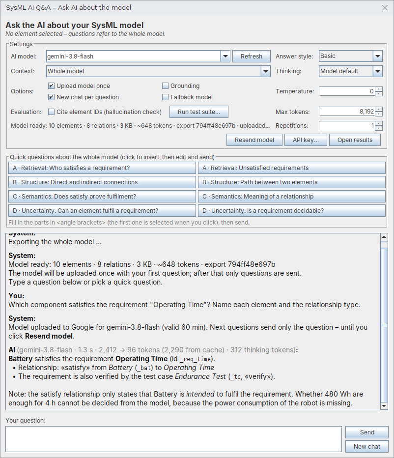

Fragen und Antworten sind auf Englisch gedacht, weil Modell und Schnellfragen englisch sind. Die KI antwortet in der Sprache der Frage, deutsche Fragen funktionieren also auch.

---

## 5. Die Antwort lesen

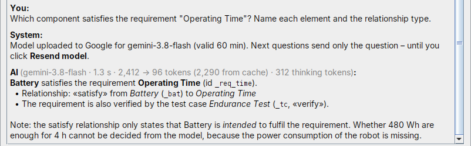

Hinter **AI** steht in Grau, wie die Antwort zustande kam:

| Angabe | Beispiel | Bedeutung |
| --- | --- | --- |
| Modell | `gemini-3.8-flash` | Welches Modell geantwortet hat. Leitet Google auf ein anderes Modell um, steht dort `angefragt → tatsächlich` |
| Dauer | `1.3 s` | Zeit vom Abschicken bis zur Antwort |
| Tokens | `2,412 → 96 tokens` | Umfang der Eingabe (Modell und Frage) → Länge der Antwort |
| Cache | `(2,290 from cache)` | Teil der Eingabe, der aus dem hochgeladenen Modell kam |
| Thinking | `312 thinking tokens` | Umfang des internen Nachdenkens |
| Wartezeit | `waited 20 s` | nur wenn Google wegen eines Limits warten ließ |
| Warnung | **fallback model!** | nur wenn ein anderes Modell als das gewählte geantwortet hat |

Bei eingeschaltetem **Cite element IDs** folgt unter der Antwort der ID-Check, z. B. *6 IDs cited, all found in model* (grün) oder *2 of 5 IDs NOT in model: …* (rot = erfundene Elemente).

Jede Antwort wird automatisch mit allen Einstellungen protokolliert (siehe [Abschnitt 9](#9-ergebnisse-finden-und-bewerten)).

---

## 6. Fragen zu einem Element

Über **Ask AI about this element…** (Rechtsklick) oder **Ask AI about the selected element…** (Menüleiste) öffnet sich das Fenster für ein einzelnes Element:

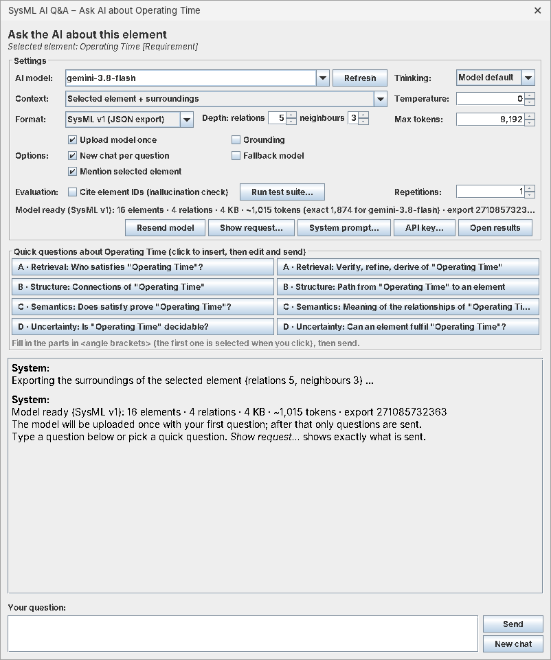

- Oben steht das gewählte Element mit Typ, z. B. *Selected element: Operating Time [Requirement]*.
- **Context** steht auf *Selected element + surroundings*. Die KI bekommt nur dieses Element und seine Umgebung. Das ist schneller, aber Fragen zu weit entfernten Teilen kann sie dann nicht beantworten. Für solche Fragen auf *Whole model* umstellen.
- Die **Schnellfragen** beziehen sich auf das gewählte Element. Für Requirements gibt es eigene Fragen (z. B. zu satisfy und verify).

---

## 7. Schnellfragen

Die Schnellfragen sind Vorlagen für die vier Fähigkeiten, die das Projekt untersucht:

| Kategorie | Prüft | Beispiel |
| --- | --- | --- |
| **A · Retrieval** | Findet die KI Informationen im Modell? | *Which component satisfies the requirement …?* |
| **B · Structure** | Verfolgt sie direkte und indirekte Verbindungen? | *Which components are directly or indirectly connected to …?* |
| **C · Semantics** | Versteht sie, was eine Beziehung bedeutet? | *Does the satisfy relationship prove that the requirement is fulfilled?* |
| **D · Uncertainty** | Erkennt sie fehlende Informationen? | *Is there enough information to decide whether … is fulfilled?* |

So geht's:

1. Eine Schnellfrage anklicken. Sie wird unten ins Eingabefeld übernommen. Mit der Maus über einen Button fahren zeigt die ganze Frage.
2. Platzhalter in spitzen Klammern ausfüllen, z. B. `<add requirement>`. Der erste Platzhalter ist nach dem Klick schon markiert und lässt sich direkt überschreiben.
3. **Send**. Steht noch ein Platzhalter in der Frage, fragt das Plugin vor dem Senden nach.

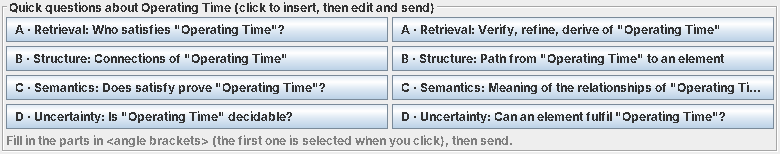

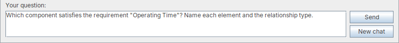

---

## 8. Testlauf mit vielen Fragen

Für Messungen werden Fragen nicht einzeln getippt, sondern als Liste in einer CSV-Datei vorbereitet und automatisch abgearbeitet.

1. **Testfälle anlegen:** Vorlage [`evaluation/testcases_template.csv`](evaluation/testcases_template.csv) in Excel öffnen. Pro Zeile eine Frage mit ID, Kategorie (A–D) und Referenzantwort. Details: [`evaluation/README.md`](evaluation/README.md).
2. Im Plugin die Einstellungen wählen (Modell, Temperatur, Thinking, Repetitions …).
3. **Run test suite…** klicken und die CSV-Datei auswählen.
4. Im folgenden Fenster prüfen:
   - Anzahl der geladenen Testfälle je Kategorie
   - **Models**: ein Modell oder mehrere, durch Komma getrennt. Mehrere Modelle laufen nacheinander mit denselben Fragen, so lassen sich Modellgrößen vergleichen
   - **Extra pause**: normalerweise 0. Bei Limits wartet das Plugin selbst
5. **OK**, danach die Sicherheitsfrage mit der Gesamtzahl der Anfragen mit **Yes** bestätigen.

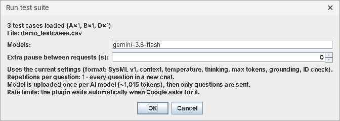

Während des Laufs erscheint pro Antwort eine Zeile mit Nummer, Testfall, Modell, *ok* oder *failed*, Dauer und dem Anfang der Antwort. **Stop test run** bricht nach der laufenden Frage ab. Bisherige Ergebnisse bleiben gespeichert.

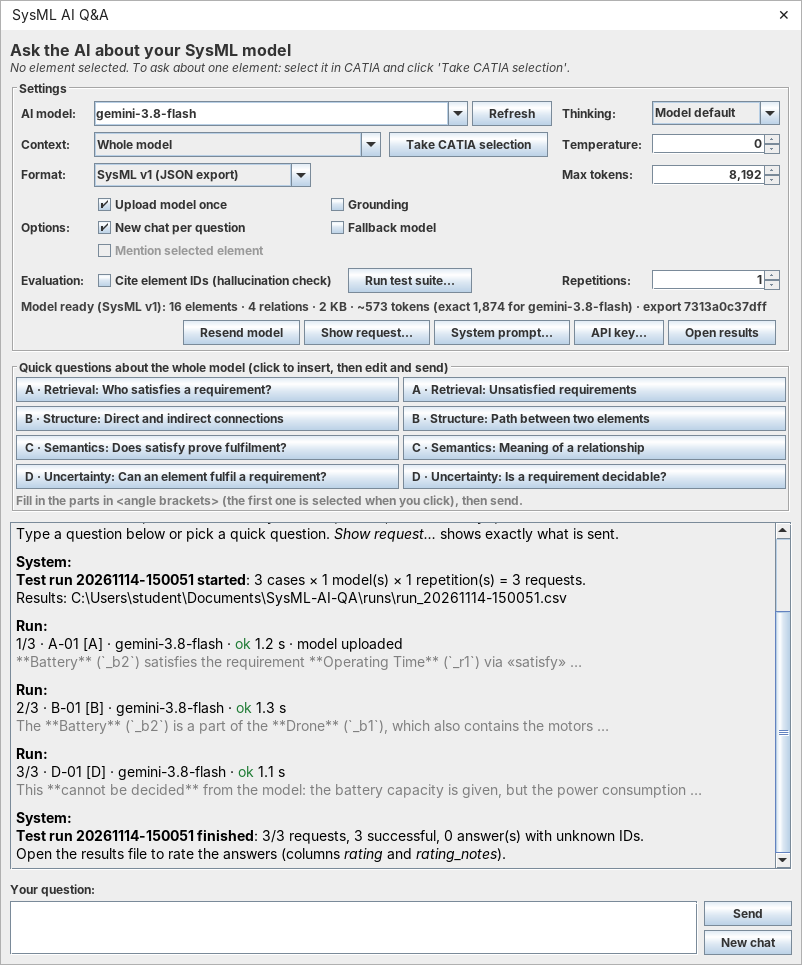

Im Testlauf gilt immer: jede Frage in einem neuen Chat, kein Fallback-Modell. Bei einem Minutenlimit wartet das Plugin automatisch. Bei einem **Tageslimit** überspringt es die restlichen Fragen für dieses Modell und meldet das in Rot.

---

## 9. Ergebnisse finden und bewerten

**Open results** öffnet den Ordner `Dokumente\SysML-AI-QA`:

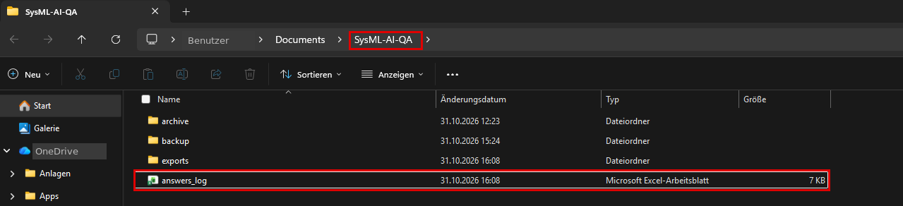

| Datei / Ordner | Inhalt |
| --- | --- |
| **`answers_log.xlsx`** | jede Antwort, auch aus dem Chat (`run_id = chat`), formatiert für Excel |
| **`runs\run_<Datum-Uhrzeit>.xlsx`** | ein Testlauf, formatiert für Excel. **Diese Datei bewerten** |
| `answers_log.csv`, `runs\….csv` | dieselben Daten als Rohdaten (für Auswertungen mit Python, R usw.) |
| `archive\prompts\` | jeder verwendete System-Prompt im Wortlaut |
| `archive\exports\` | jeder verwendete Modellexport |
| `backup\` | nur falls bei der Installation eine sehr alte Version verschoben wurde |

Die **.xlsx**-Dateien sind zum Lesen und Bewerten gedacht. Jede Zeile ist eine Antwort:

- Vorne stehen die wichtigen Spalten: Testlauf, Testfall, Kategorie, Frage, Referenzantwort, Antwort, Bewertung, Modellversion, Erfolg, Dauer und erfundene IDs.
- Die Kopfzeile bleibt beim Scrollen stehen, jede Spalte hat einen Filter (Pfeil in der Kopfzeile).
- **rating** und **rating_notes** (gelb) sind für eure Bewertung. In *rating* gibt es eine Auswahlliste (*correct, partial, wrong, hallucinated, correctly_refused*), eigene Werte sind auch erlaubt.
- Lange Antworten sind gekürzt sichtbar. Ganzer Text: Zelle anklicken und oben in der Bearbeitungsleiste lesen oder die Zeile größer ziehen. Markdown-Zeichen wie `**` sind entfernt, der Originaltext steht in der CSV.
- Technische Spalten (Tokens, Prüfsummen, Einstellungen …) sind eingeklappt. Mit dem **+** über der Spalte *ids_unknown* klappt man sie auf.
- Das zweite Blatt **Columns** erklärt jede Spalte.

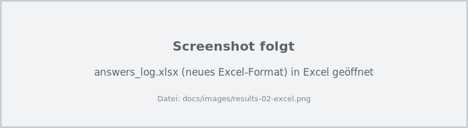

Tipps:

- **Bewerten in der Datei des Testlaufs** (`runs\run_….xlsx`). Sie wird nur während des Laufs geschrieben und danach nicht mehr verändert.
- **`answers_log.xlsx` nicht zum Bewerten nutzen.** Sie wird nach jeder Antwort neu erzeugt, Einträge darin gehen verloren. Wer dort bewerten will: *Datei → Speichern unter* mit neuem Namen.
- Ist eine `.xlsx` gerade in Excel offen, kann das Plugin sie nicht aktualisieren und meldet das im Chat. Nach dem Schließen wird sie beim nächsten Mal (oder über **Open results**) nachgezogen.
- Alle Spalten sind in [`evaluation/README.md`](evaluation/README.md) erklärt.

---

## 10. Empfohlene Einstellungen für Messungen

| Einstellung | Wert | Warum |
| --- | --- | --- |
| Temperature | 0 | möglichst reproduzierbare Antworten |
| Grounding | aus | Antwort nur aus dem Modell, nicht aus dem Internet |
| Fallback model | aus | keine vermischten Modelle |
| New chat per question | an | Fragen beeinflussen sich nicht gegenseitig |
| Thinking | innerhalb eines Experiments fest | beeinflusst Qualität und Dauer |
| Answer style, Cite element IDs | innerhalb eines Experiments fest | ändern den System-Prompt |
| Repetitions | mehr als 1 (Anzahl im Team festlegen) | macht Schwankungen sichtbar |
| Context | *Whole model* | alle Fragen bekommen dieselbe Grundlage |

Grundregel: Pro Experiment genau **eine** Größe ändern, z. B. nur das KI-Modell oder nur das Testmodell. Vorher in CATIA geändert? Dann zuerst **Resend model**.

---

## 11. Häufige Fragen

**Die Antwort bezieht sich auf einen alten Stand des Modells.**
Nach Änderungen in CATIA **Resend model** klicken. Das Fenster arbeitet mit dem Export vom Öffnen.

**Die erste Antwort dauert lange, die weiteren gehen schneller.**
Normal: Bei der ersten Frage wird das Modell hochgeladen. Schneller geht es mit kleinerem *Context*, weniger *Thinking* oder einem kleineren Modell.

**Unter der Antwort steht „Answer cut off: max. output tokens reached“.**
**Max tokens** erhöhen, z. B. auf 16.384.

**„Daily limit reached“ oder HTTP 429.**
Das Free-Tier-Limit von Google ist erreicht. Beim Minutenlimit wartet das Plugin selbst. Beim Tageslimit bis zum nächsten Tag warten oder ein anderes Modell wählen.

**Die Schnellfragen passen nicht zu meinem Element.**
Prüfen, ob *Context* auf *Selected element + surroundings* steht. Bei *Whole model* zeigt das Plugin die Fragen zum ganzen Modell.

**Wo kann ich sehen, was das Plugin im Hintergrund macht?**
In CATIA unter **Window → Notification Window**. Alle Meldungen beginnen mit `[SysML AI Q&A]`.

Weitere Fehlerbilder: [`INSTALL.md`](INSTALL.md#wenn-etwas-nicht-klappt).
