# SysML AI Q&A – Benutzerhandbuch

Dieses Handbuch erklärt das Plugin-Fenster nach der Installation: wo jede Einstellung ist, was sie bewirkt und welche Werte für Messungen sinnvoll sind. Stand: **Version 3.4**. Installiert und aktualisiert wird nach [`INSTALL.md`](INSTALL.md).

> **Zu den Bildern:** Das erste Bild ist ein echter Screenshot aus CATIA. Die übrigen zeigen das echte Plugin-Fenster mit einem kleinen Demo-Modell (Roboter mit Batterie, Antrieb, Chassis, drei Anforderungen und einem Testfall) und Beispielantworten. In CATIA sieht das Fenster je nach Windows-Design etwas anders aus. Aufbau und Beschriftungen sind gleich.

**Inhalt**

1. [Fenster öffnen](#1-fenster-öffnen)
2. [Das Fenster im Überblick](#2-das-fenster-im-überblick)
3. [Alle Einstellungen erklärt](#3-alle-einstellungen-erklärt)
4. [Umfang und Format wählen](#4-umfang-und-format-wählen)
5. [Eine Frage stellen](#5-eine-frage-stellen)
6. [Die Antwort lesen](#6-die-antwort-lesen)
7. [Sehen und ändern, was gesendet wird](#7-sehen-und-ändern-was-gesendet-wird)
8. [Fragen zu einem Element](#8-fragen-zu-einem-element)
9. [Schnellfragen](#9-schnellfragen)
10. [Testlauf mit vielen Fragen](#10-testlauf-mit-vielen-fragen)
11. [Ergebnisse finden und bewerten](#11-ergebnisse-finden-und-bewerten)
12. [Empfohlene Einstellungen für Messungen](#12-empfohlene-einstellungen-für-messungen)
13. [KI-Modelle, Kosten und Größenlimit](#13-ki-modelle-kosten-und-größenlimit)
14. [Häufige Fragen](#14-häufige-fragen)

---

## 1. Fenster öffnen

Es gibt **einen** Menüeintrag, **Ask AI…**:

| Wo | Menüpunkt | Ausgewähltes Element |
| --- | --- | --- |
| Rechtsklick im Containment Tree oder in einem Diagramm | **Ask AI (SysML AI Q&A) → Ask AI…** | das angeklickte Element |
| Menüleiste | **Ask AI → Ask AI…** | das gerade markierte Element (auch eine Tabellenzeile), sonst keins |

In einer **Requirement-Tabelle** erscheint beim Rechtsklick kein Eintrag. Dann die Zeile markieren und den Weg über die Menüleiste nehmen.

Das Fenster öffnet sich **ohne Export**. Zuerst **Context** (ganzes Modell, ausgewählte Pakete oder ausgewähltes Element mit Umgebung) und **Format** wählen, dann **Export model** klicken. Erst jetzt exportiert das Plugin aus CATIA; das dauert je nach Modellgröße einige Sekunden. Danach steht im Einstellungsbereich **Model ready (SysML v1): …** mit der Anzahl der Elemente und Beziehungen, der Größe und den Tokens. Kurz darauf ergänzt das Plugin die **exakte** Tokenzahl für das gewählte KI-Modell (*exact … for …*). Der Context vom letzten Mal ist voreingestellt.

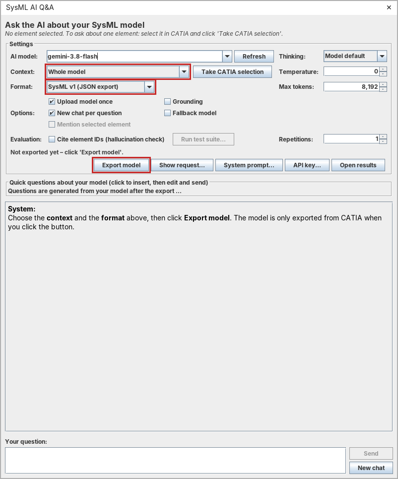

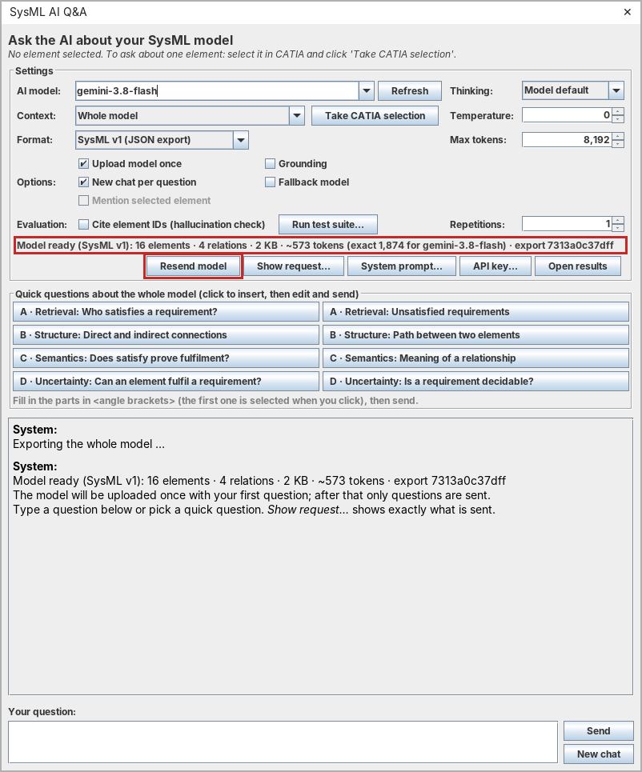

Oben steht das ausgewählte Element (*Selected element: …*) oder, wenn keins ausgewählt ist, ein Hinweis. Ohne ausgewähltes Element ist im Context-Feld *Selected element + surroundings* **grau**; beim Darüberfahren steht der Grund. Mit **Take CATIA selection** übernimmt das Plugin das gerade in CATIA markierte Element, ohne dass das Fenster neu geöffnet werden muss. Während des Exports sind *Context*, *Format* und *Run test suite…* ausgegraut, unten steht *Busy…*. Sobald **Model ready** erscheint, ist alles bedienbar.

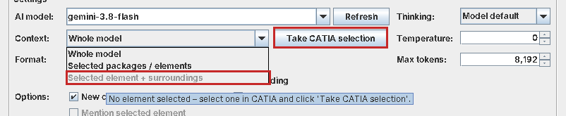

**Context nach dem Export geändert?** Dann steht in der Statuszeile *Context changed – click 'Export model'*, und *Send* sowie *Run test suite…* sind gesperrt, bis neu exportiert wurde. So passt das Protokoll immer zum gesendeten Modell. Ein Wechsel zwischen *SysML v1 (JSON export)* und *SysML v2 (converted from v1)* braucht keinen neuen Export.

---

## 2. Das Fenster im Überblick

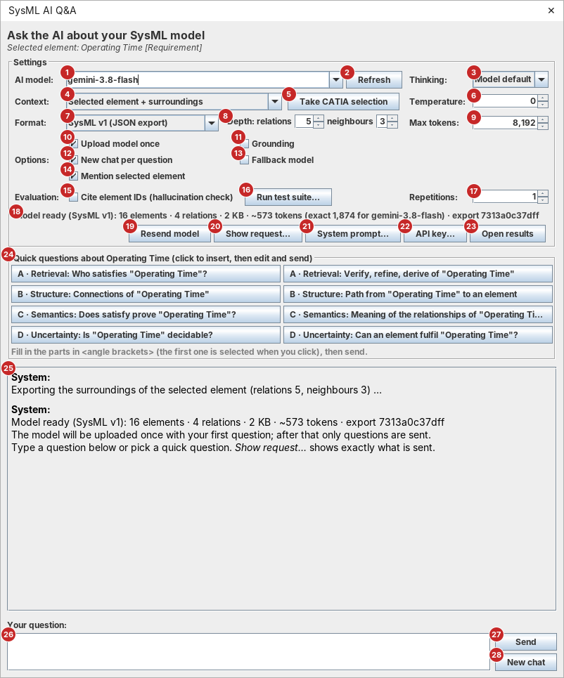

Das Bild zeigt das Fenster für ein Element, weil es dort alle Einstellungen gibt. Beim Fenster für das ganze Modell fehlen *Depth* (8), und *Mention selected element* (14) ist ausgegraut. *Choose…* (5) erscheint nur bei *Context: Selected packages / elements*, siehe [Abschnitt 4](#4-umfang-und-format-wählen).

Das Fenster hat vier Bereiche, von oben nach unten:

| Bereich | Nummern | Wozu |
| --- | --- | --- |
| **Settings** | 1–23 | KI-Modell, Umfang, Format und Versuchsparameter einstellen, Anfrage und System-Prompt ansehen, Testlauf starten, Ergebnisse öffnen |
| **Quick questions** | 24 | Fragevorlagen zum Anklicken |
| **Chatverlauf** | 25 | Fragen, Antworten und Systemmeldungen |
| **Your question** | 26–28 | Frage eintippen, abschicken oder abbrechen |

Alle Einstellungen werden automatisch gespeichert und beim nächsten Öffnen wiederhergestellt. Ausnahme: **Context** richtet sich danach, über welchen Menüpunkt das Fenster geöffnet wurde.

---

## 3. Alle Einstellungen erklärt

| Nr. | Bedienelement | Was es bewirkt | Standard |
| --- | --- | --- | --- |
| 1 | **AI model** | Welches Gemini-Modell antwortet. Auswählen oder eine Modell-ID eintippen. Vorgeschlagen sind `gemini-3.8-flash`, `gemini-3.6-flash`, `gemini-3.5-flash-lite` und `gemini-3.1-flash-lite`. Ein Wechsel zählt die Tokens für das neue Modell nach | `gemini-3.8-flash` |
| 2 | **Refresh** | Lädt die Liste aller Modelle, die für deinen API-Key verfügbar sind. Wichtig für den Vergleich verschiedener Modellgrößen | – |
| 3 | **Thinking** | Wie viel die KI vor der Antwort „nachdenkt“: *Model default*, *Minimal*, *Low*, *Medium*, *High*. Weniger Denken ist schneller, kann aber bei indirekten Zusammenhängen schlechter sein. Kann ein Modell die Stufe nicht, wird der Modell-Standard genommen (steht im Log) | Model default |
| 4 | **Context** | Welcher Teil des Modells an die KI geht: *Whole model*, *Selected packages / elements* oder *Selected element + surroundings* (grau, solange kein Element ausgewählt ist). Nach einem Wechsel **Export model** klicken. Details in [Abschnitt 4](#4-umfang-und-format-wählen) | wie zuletzt |
| 5 | **Choose…** / **Take CATIA selection** | *Choose…* (nur bei *Selected packages / elements*): Pakete oder Elemente im Modellbaum auswählen. *Take CATIA selection*: das in CATIA markierte Element übernehmen und Context auf *Selected element + surroundings* stellen | – |
| 6 | **Temperature** | Zufälligkeit der Antwort, 0 bis 2. *0* = möglichst gleiche Antworten bei gleicher Frage (empfohlen für Messungen), höher = abwechslungsreicher | 0 |
| 7 | **Format** | Welches Modell in welcher Form gesendet wird: *SysML v1 (JSON export)* für SysML-v1-Modelle, *SysML v2 (converted from v1)* für dasselbe v1-Modell in SysML-v2-Schreibweise, *SysML v2 model (CATIA export)* für **SysML-v2-Projekte** (siehe [Abschnitt 4](#4-umfang-und-format-wählen)). Jedes Format hat einen eigenen System-Prompt | SysML v1 |
| 8 | **Depth: relations / neighbours** | Nur bei *Selected element + surroundings*: wie viele Beziehungsschritte vom Element aus verfolgt werden (0–10) und über wie viele Besitzer-Ebenen Nachbarelemente dazukommen (0–5). Nach einer Änderung **Export model** klicken | 5 / 3 |
| 9 | **Max tokens** | Maximale Länge der Antwort, inklusive internem Nachdenken. Wird eine Antwort abgeschnitten, steht ein Hinweis darunter: dann erhöhen | 8.192 |
| 10 | **Upload model once** | An: System-Prompt und Modell werden mit der ersten Frage einmal bei Google hochgeladen (60 Minuten gültig), danach geht nur noch die Frage raus. Das spart Übertragung und Zeit; der Inhalt der Anfrage bleibt gleich. Nicht jedes Modell erlaubt das im Free Tier (z. B. Flash-Lite), dann wird das Modell automatisch mit jeder Frage geschickt | an |
| 11 | **Grounding** | Erlaubt der KI eine Google-Suche. Für Messungen **aus** lassen, denn die Antwort soll nur aus dem Modell kommen | aus |
| 12 | **New chat per question** | An: Jede Frage wird unabhängig beantwortet, die KI kennt die vorherigen Fragen nicht. Aus: Folgefragen bauen auf dem bisherigen Gespräch auf (z. B. „Und welche Masse hat es?“) | an |
| 13 | **Fallback model** | An: Ist das gewählte Modell überlastet, probiert das Plugin automatisch andere Modelle. Für Messungen **aus** lassen, sonst sind Ergebnisse verschiedener Modelle vermischt | aus |
| 14 | **Mention selected element** | Nur wenn ein Element ausgewählt ist. An: Die erste Frage eines Chats beginnt mit *# Currently selected element* und Name, Typ, ID und Besitzer des Elements (genauer Text im Tooltip). Aus: Über die Auswahl wird nichts gesendet | an |
| 15 | **Cite element IDs (hallucination check)** | Die KI muss zu jedem genannten Element dessen ID angeben. Das Plugin prüft dann, ob es diese IDs im Modell gibt, und markiert erfundene. Ändert den System-Prompt | aus |
| 16 | **Run test suite…** | Startet einen Testlauf mit Fragen aus einer CSV-Datei (siehe [Abschnitt 10](#10-testlauf-mit-vielen-fragen)). Während des Laufs heißt der Button *Stop test run* | – |
| 17 | **Repetitions** | Wie oft jede Frage gestellt wird (1–20), jedes Mal in einem neuen Chat. Mehr als 1 zeigt, wie stabil die Antworten sind | 1 |
| 18 | **Statuszeile** | Format, Anzahl Elemente und Beziehungen, Größe, geschätzte Tokens, die **exakte** Tokenzahl für das gewählte KI-Modell und eine Prüfsumme (`export …`). Nach dem Hochladen zusätzlich *uploaded for …*. Ist das Modell größer als das Eingabelimit des KI-Modells, wird die Zeile rot. Mit der Maus darüberfahren zeigt den vollen Text und den Umfang | – |
| 19 | **Export model** / **Resend model** | Exportiert den gewählten Context aus CATIA. Vor dem ersten Export und nach einer Änderung des Contexts heißt der Button *Export model*, sonst *Resend model*. Lädt das Modell mit der nächsten Frage neu hoch. **Nach jeder Änderung am Modell in CATIA klicken**, sonst antwortet die KI zum alten Stand | – |
| 20 | **Show request…** | Zeigt genau, was mit der nächsten Frage gesendet wird, und speichert es auf Wunsch (siehe [Abschnitt 7](#7-sehen-und-ändern-was-gesendet-wird)) | – |
| 21 | **System prompt…** | System-Prompt je Format ansehen und ändern (siehe [Abschnitt 7](#7-sehen-und-ändern-was-gesendet-wird)) | – |
| 22 | **API key…** | API-Key ansehen oder ändern | – |
| 23 | **Open results** | Öffnet den Ergebnisordner `Dokumente\SysML-AI-QA` | – |
| 24 | **Quick questions** | Fragevorlagen nach den Kategorien A–D (siehe [Abschnitt 9](#9-schnellfragen)) | – |
| 25 | **Chatverlauf** | *System*: Meldungen des Plugins. *You*: deine Fragen. *AI*: Antworten mit Messwerten | – |
| 26 | **Your question** | Frage eintippen. **Enter** schickt ab, **Shift+Enter** macht eine neue Zeile | – |
| 27 | **Send / Stop** | Frage abschicken. Während die KI arbeitet, steht dort **Stop**: bricht die Anfrage sofort ab | – |
| 28 | **New chat** | Löscht den Chatverlauf. Das exportierte Modell bleibt geladen | – |

**Wann wird das Modell neu hochgeladen?** Nach jedem Export (*Export model* / *Resend model*) und automatisch, wenn sich das KI-Modell, das Format, der System-Prompt, der ID-Check oder Grounding ändert. Grund: Diese Dinge gehören zum hochgeladenen Paket.

---

## 4. Umfang und Format wählen

**Context** legt fest, welcher Teil des Modells an die KI geht:

| Context | Was die KI bekommt | Wann sinnvoll |
| --- | --- | --- |
| **Whole model** | alles außer den SysML/UML-Bibliotheken | Standard für Messungen: alle Fragen haben dieselbe Grundlage |
| **Selected packages / elements** | nur die gewählten Pakete oder Elemente, jeweils mit allem, was sie enthalten | Einfluss der Modellgröße untersuchen; große Modelle unter das Eingabelimit eines kleinen KI-Modells bringen |
| **Selected element + surroundings** | das Element, seine Besitzer, Nachbarn und verbundene Elemente bis zur eingestellten Tiefe (*Depth*) | Fragen zu einem Element; untersuchen, ob mehr Kontext hilft |

**Pakete oder Elemente wählen:**

1. *Context* auf **Selected packages / elements** stellen. Der Auswahldialog öffnet sich beim ersten Mal von selbst, später über **Choose…** (5).
2. Im Modellbaum ein oder mehrere Pakete oder Elemente markieren (**Strg+Klick** für mehrere). Im Containment Tree markierte Elemente sind schon vorausgewählt.
3. Im Auswahldialog **Use selection** klicken, dann **Export model**. Die Statuszeile zeigt die neue Größe.

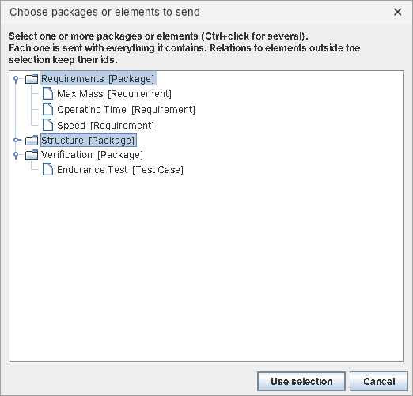

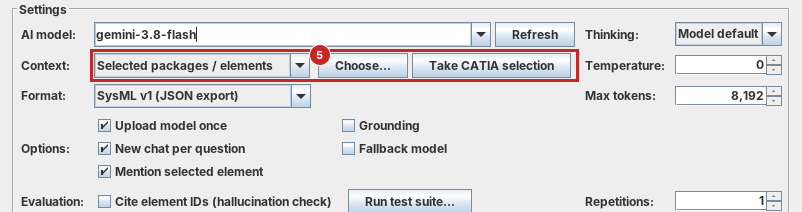

Beziehungen zu Elementen außerhalb der Auswahl bleiben als ID erhalten. Die KI sieht dann, dass es eine Beziehung gibt, aber nicht, wohin sie führt.

**Format** – SysML v1 oder SysML v2:

In CATIA kann man SysML-v1- und SysML-v2-Modelle anlegen. Das Plugin kann beide schicken:

| Format | Für | Was gesendet wird |
| --- | --- | --- |
| **SysML v1 (JSON export)** | SysML-v1-Projekte | der Export des Plugins (JSON), Umfang über *Context* |
| **SysML v2 (converted from v1)** | SysML-v1-Projekte | dasselbe v1-Modell in SysML-v2-Schreibweise, z. B. `part def <_bat> Battery { … }`. Gleicher Inhalt, andere Notation |
| **SysML v2 model (CATIA export)** | **SysML-v2-Projekte** | genau der SysML-v2-Text, den CATIA selbst exportiert (`.sysml`-Dateien) |

**Ein SysML-v2-Modell schicken:**

1. In CATIA das SysML-v2-Projekt öffnen und das Plugin über **Ask AI → Ask AI…** öffnen.
2. **Format** auf **SysML v2 model (CATIA export)** stellen.
3. **Export in CATIA…** (B) klicken. Es öffnet sich der Export von CATIA (*File → Export To → SysML v2 Textual Notation*). Dort die Namespaces wählen, einen Ordner angeben und **Export** klicken.
4. Im Plugin **Files…** (A) klicken und den Ordner oder die `.sysml`-Dateien wählen (oder **Export model**, um die zuletzt gewählten Dateien zu lesen). Mehrere Dateien werden zu einem Text zusammengefasst, jede beginnt mit `// ===== File: … =====`.
5. Die Statuszeile zeigt **Model ready (SysML v2 from CATIA)** mit Deklarationen, Beziehungen und Tokens. Jetzt Fragen stellen wie gewohnt.

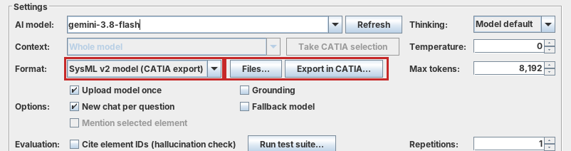

Gut zu wissen:

- Das Plugin merkt sich die gewählten Dateien. **Nach Änderungen am Modell** in CATIA erneut exportieren (gleicher Ordner) und **Resend model** klicken – das Plugin liest die Dateien dann neu. Sind die Dateien älter als eine Stunde, weist das Plugin darauf hin.
- **Context** und **Depth** gelten nur für SysML-v1-Modelle und sind bei SysML v2 ausgegraut. Den Umfang wählt man bei SysML v2 im Export-Dialog von CATIA über die **Namespaces**.
- **Cite element IDs** funktioniert auch bei SysML v2: Die KI nennt dann den qualifizierten Namen, z. B. `[id:RobotSystem::Battery]`, und das Plugin prüft, ob es ihn im Modell gibt.
- Die Schnellfragen werden aus den Namen im SysML-v2-Text erzeugt.
- Exportiert man in einem SysML-v2-Projekt mit Format *SysML v1*, findet der Export keine SysML-v1-Elemente. Das Plugin weist dann auf das Format *SysML v2 model (CATIA export)* hin.
- Warum über den Export von CATIA? CATIA hat für SysML v2 keine dokumentierte Programmierschnittstelle zum Auslesen. Der eigene Export von CATIA liefert die offizielle SysML-v2-Notation unverändert.

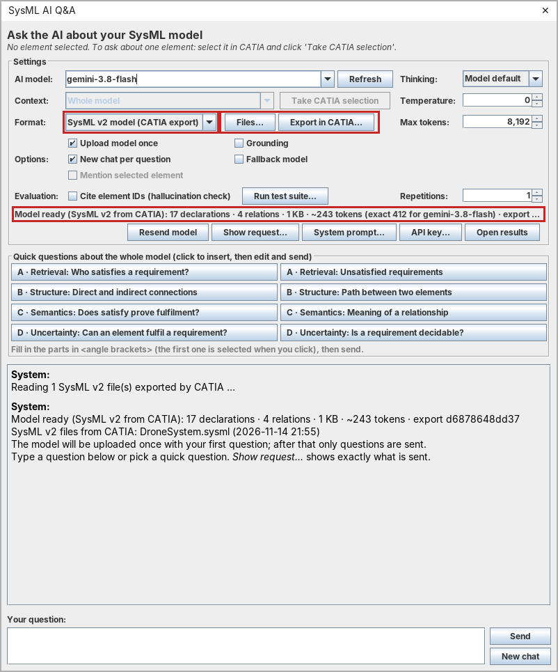

Alle Regeln zu Umfang und Formaten: [`docs/EXPORTFORMATE.md`](docs/EXPORTFORMATE.md).

---

## 5. Eine Frage stellen

1. Warten, bis die Statuszeile **Model ready** zeigt.
2. Unten bei **Your question** eine Frage eintippen, z. B. *Which component satisfies the requirement "Operating Time"?*
3. **Enter** drücken oder **Send** klicken.
4. Im Chat erscheint *Waiting for gemini-… …*. Bei der ersten Frage meldet das Plugin außerdem, dass das Modell hochgeladen wurde.

Fragen und Antworten sind auf Englisch gedacht, weil Modell und Schnellfragen englisch sind. Die Antwortsprache gibt das Plugin nicht vor: Die KI antwortet meist in der Sprache der Frage. Wer eine bestimmte Sprache will, schreibt das in die Frage.

**Abbrechen:** Während die KI arbeitet, wird **Send** zu **Stop**. Ein Klick bricht die Anfrage sofort ab, auch wenn das Plugin gerade wegen eines Limits wartet. Im Chat steht dann *Cancelled by user.*, im Log `finish_reason = CANCELLED`.

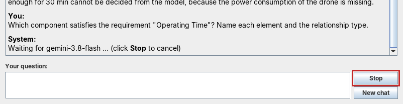

---

## 6. Die Antwort lesen

Hinter **AI** steht in Grau, wie die Antwort zustande kam:

| Angabe | Beispiel | Bedeutung |
| --- | --- | --- |
| Modell | `gemini-3.8-flash` | Welches Modell geantwortet hat. Leitet Google auf ein anderes Modell um, steht dort `angefragt → tatsächlich` |
| Dauer | `1.4 s` | Zeit vom Abschicken bis zur Antwort |
| Tokens | `2,412 → 96 tokens` | Umfang der Eingabe (System-Prompt, Modell, Chat und Frage) → Länge der Antwort |
| Cache | `(2,290 from cache)` | Teil der Eingabe, der aus dem hochgeladenen Modell kam |
| Thinking | `312 thinking tokens` | Umfang des internen Nachdenkens |
| Gesamt | `2,820 total` | insgesamt verbrauchte Tokens dieser Anfrage laut Google (Eingabe + Antwort + Denken + Suche) |
| Wartezeit | `waited 20 s` | nur wenn Google wegen eines Limits warten ließ |
| Warnung | **fallback model!** | nur wenn ein anderes Modell als das gewählte geantwortet hat |

Bei eingeschaltetem **Cite element IDs** folgt unter der Antwort der ID-Check, z. B. *6 IDs cited, all found in model* (grün) oder *2 of 5 IDs NOT in model: …* (rot = erfundene Elemente).

Kommt keine Antwort, steht statt der Antwort eine Meldung mit Grund und Abhilfe, z. B. *Model data too large for …* oder *Empty answer from …* (siehe [Häufige Fragen](#14-häufige-fragen)).

Jede Antwort wird automatisch mit allen Einstellungen protokolliert (siehe [Abschnitt 11](#11-ergebnisse-finden-und-bewerten)).

---

## 7. Sehen und ändern, was gesendet wird

**Show request…** zeigt in Reitern genau das, was mit der nächsten Frage an die KI geht. Steht schon eine Frage im Eingabefeld, ist sie enthalten.

| Reiter | Inhalt |
| --- | --- |
| **System prompt** | die Anweisung an die KI, so wie sie gesendet wird, und woher sie stammt |
| **Model data** | die Modelldaten im gewählten Format mit Größe, Tokens, Prüfsumme und Umfang |
| **Earlier chat** | nur bei ausgeschaltetem *New chat per question*: frühere Fragen und Antworten, die erneut mitgehen |
| **Question** | die Frage-Nachricht, ggf. mit dem ausgewählten Element davor |
| **Parameters** | Modell, Temperatur, Max tokens, Thinking, Grounding, Übertragung |

**Save all…** speichert alle Teile als einzelne Dateien in einen gewählten Ordner, z. B. für die Dokumentation eines Experiments. Es wird nichts gesendet, das hier nicht steht.

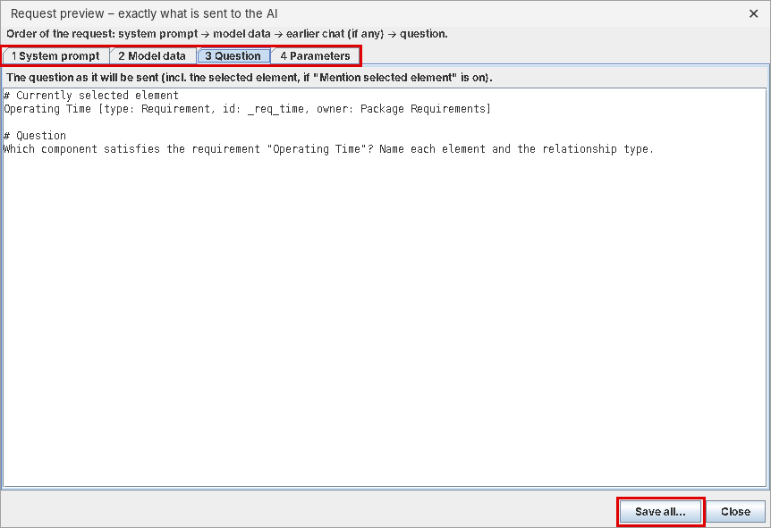

**System prompt…** zeigt den System-Prompt und lässt ihn ändern:

1. Oben das Format wählen (*SysML v1* oder *SysML v2*). Jedes Format hat einen eigenen Prompt.
2. Text ändern. `{idInstruction}` steht für die Anweisung, IDs zu nennen. Sie wird bei *Cite element IDs* eingesetzt, sonst entfernt.
3. **Save**. Der neue Prompt gilt ab der nächsten Frage. **Reset to default** stellt die Standardfassung wieder her.

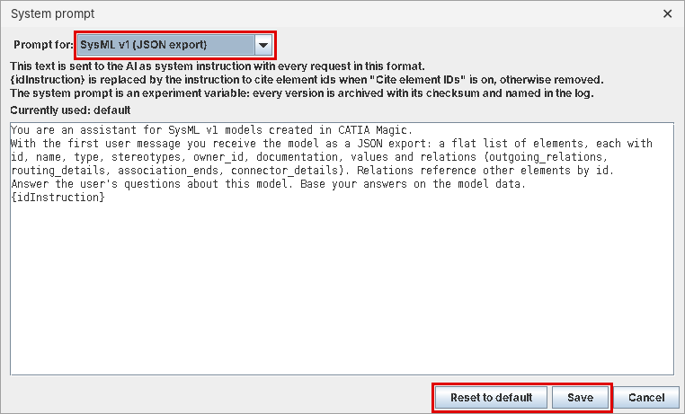

Eigene Fassungen liegen unter `Dokumente\SysML-AI-QA\prompts`. Der System-Prompt ist eine **Versuchsvariable**: Jede verwendete Fassung wird im Wortlaut unter `archive\prompts` abgelegt, im Log stehen ihre Prüfsumme (`system_prompt_sha`) und ihre Herkunft (`system_prompt_source`: *default*, *custom* oder *installed*). Innerhalb eines Experiments nicht ändern.

---

## 8. Fragen zu einem Element

Element per Rechtsklick → **Ask AI…** öffnen (oder im offenen Fenster das Element in CATIA markieren und **Take CATIA selection** klicken), *Context* auf **Selected element + surroundings** stellen und **Export model** klicken:

- Oben steht das gewählte Element mit Typ, z. B. *Selected element: Operating Time [Requirement]*.
- **Context** steht auf *Selected element + surroundings*. Die KI bekommt nur dieses Element und seine Umgebung. Das ist schneller, aber Fragen zu weit entfernten Teilen kann sie dann nicht beantworten. Dann **Depth** erhöhen oder auf *Whole model* umstellen.
- **Mention selected element** (an) nennt der KI das gewählte Element bei der ersten Frage. Ausschalten, wenn die KI das Element selbst finden soll.
- Die **Schnellfragen** beziehen sich auf das gewählte Element. Für Requirements gibt es eigene Fragen (z. B. zu satisfy und verify).

---

## 9. Schnellfragen

Die Schnellfragen sind Vorlagen für die vier Fähigkeiten, die das Projekt untersucht:

| Kategorie | Prüft | Beispiel |
| --- | --- | --- |
| **A · Retrieval** | Findet die KI Informationen im Modell? | *Which component satisfies the requirement …?* |
| **B · Structure** | Verfolgt sie direkte und indirekte Verbindungen? | *Which components are directly or indirectly connected to …?* |
| **C · Semantics** | Versteht sie, was eine Beziehung bedeutet? | *Does the satisfy relationship prove that the requirement is fulfilled?* |
| **D · Uncertainty** | Erkennt sie fehlende Informationen? | *Is there enough information to decide whether … is fulfilled?* |

So geht's:

1. Eine Schnellfrage anklicken. Sie wird unten ins Eingabefeld übernommen. Mit der Maus über einen Button fahren zeigt die ganze Frage.
2. Platzhalter in spitzen Klammern ausfüllen, z. B. `<add requirement>`. Der erste Platzhalter ist nach dem Klick schon markiert und lässt sich direkt überschreiben.
3. **Send**. Steht noch ein Platzhalter in der Frage, fragt das Plugin vor dem Senden nach.

---

---

## 10. Testlauf mit vielen Fragen

Für Messungen werden Fragen nicht einzeln getippt, sondern als Liste in einer CSV-Datei vorbereitet und automatisch abgearbeitet.

1. **Testfälle anlegen:** Vorlage [`evaluation/testcases_template.csv`](evaluation/testcases_template.csv) in Excel öffnen. Pro Zeile eine Frage mit ID, Kategorie (A–D) und Referenzantwort. Details: [`evaluation/README.md`](evaluation/README.md).
2. Im Plugin die Einstellungen wählen (Modell, Context, Format, Temperatur, Thinking, Repetitions …). Der Testlauf nutzt genau diese Einstellungen und den aktuellen System-Prompt.
3. **Run test suite…** klicken und die CSV-Datei auswählen.
4. Im folgenden Fenster prüfen:
   - Anzahl der geladenen Testfälle je Kategorie
   - **Models**: ein Modell oder mehrere, durch Komma getrennt. Mehrere Modelle laufen nacheinander mit denselben Fragen, so lassen sich Modellgrößen vergleichen
   - **Extra pause**: normalerweise 0. Bei Limits wartet das Plugin selbst
5. **OK**, danach die Sicherheitsfrage mit der Gesamtzahl der Anfragen mit **Yes** bestätigen.

Während des Laufs erscheint pro Antwort eine Zeile mit Nummer, Testfall, Modell, *ok* oder *failed*, Dauer und dem Anfang der Antwort. **Stop test run** bricht sofort ab, auch die gerade laufende Frage. Bisherige Ergebnisse bleiben gespeichert.

Im Testlauf gilt immer: jede Frage in einem neuen Chat, kein Fallback-Modell. Bei einem Minutenlimit wartet das Plugin automatisch. Bei einem **Tageslimit** überspringt es die restlichen Fragen für dieses Modell und meldet das in Rot.

---

---

## 11. Ergebnisse finden und bewerten

**Open results** öffnet den Ordner `Dokumente\SysML-AI-QA`:

| Datei / Ordner | Inhalt |
| --- | --- |
| **`answers_log.xlsx`** | jede Antwort, auch aus dem Chat (`run_id = chat`), formatiert für Excel |
| **`runs\run_<Datum-Uhrzeit>.xlsx`** | ein Testlauf, formatiert für Excel. **Diese Datei bewerten** |
| `answers_log.csv`, `runs\….csv` | dieselben Daten als Rohdaten (für Auswertungen mit Python, R usw.) |
| `archive\prompts\` | jeder verwendete System-Prompt im Wortlaut |
| `archive\exports\` | jeder verwendete Modellexport, genau wie gesendet (`.json` für SysML v1, `.sysml` für SysML v2) |
| `prompts\` | eure im Fenster geänderten System-Prompts (nur wenn ihr einen geändert habt) |
| `backup\` | nur falls bei der Installation eine sehr alte Version verschoben wurde |

Die **.xlsx**-Dateien sind zum Lesen und Bewerten gedacht. Jede Zeile ist eine Antwort:

- Vorne stehen die wichtigen Spalten: Testlauf, Testfall, Kategorie, Frage, Referenzantwort, Antwort, Bewertung, Modellversion, Erfolg, Dauer, **verbrauchte Tokens** (Eingabe, Antwort, Denken, gesamt) und erfundene IDs.
- Die Kopfzeile bleibt beim Scrollen stehen, jede Spalte hat einen Filter (Pfeil in der Kopfzeile).
- **rating** und **rating_notes** (gelb) sind für eure Bewertung. In *rating* gibt es eine Auswahlliste (*correct, partial, wrong, hallucinated, correctly_refused*), eigene Werte sind auch erlaubt.
- Lange Antworten sind gekürzt sichtbar. Ganzer Text: Zelle anklicken und oben in der Bearbeitungsleiste lesen oder die Zeile größer ziehen. Markdown-Zeichen wie `**` sind entfernt, der Originaltext steht in der CSV.
- Technische Spalten (Tokens, Prüfsummen, Einstellungen …) sind eingeklappt. Mit dem **+** über der Spalte *ids_unknown* klappt man sie auf.
- Das zweite Blatt **Columns** erklärt jede Spalte.
- Das dritte Blatt **Tokens** summiert Anfragen, Dauer und verbrauchte Tokens je antwortendem Modell und insgesamt.
- In den eingeklappten Spalten steht **jede Einstellung** der Anfrage: Modell, Temperatur, Max tokens, Thinking, Grounding, New chat, Cite IDs, Fallback, Upload once, Mention selected element, Repetitions, Pause, Context, Depth, Format und System-Prompt.

Tipps:

- **Bewerten in der Datei des Testlaufs** (`runs\run_….xlsx`). Sie wird nur während des Laufs geschrieben und danach nicht mehr verändert.
- **`answers_log.xlsx` nicht zum Bewerten nutzen.** Sie wird nach jeder Antwort neu erzeugt, Einträge darin gehen verloren. Wer dort bewerten will: *Datei → Speichern unter* mit neuem Namen.
- Ist eine `.xlsx` gerade in Excel offen, kann das Plugin sie nicht aktualisieren und meldet das im Chat. Nach dem Schließen wird sie beim nächsten Mal (oder über **Open results**) nachgezogen.
- Alle Spalten sind in [`evaluation/README.md`](evaluation/README.md) erklärt.

---

---

## 12. Empfohlene Einstellungen für Messungen

| Einstellung | Wert | Warum |
| --- | --- | --- |
| Temperature | 0 | möglichst reproduzierbare Antworten |
| Grounding | aus | Antwort nur aus dem Modell, nicht aus dem Internet |
| Fallback model | aus | keine vermischten Modelle |
| New chat per question | an | Fragen beeinflussen sich nicht gegenseitig |
| Thinking | innerhalb eines Experiments fest | beeinflusst Qualität und Dauer |
| Cite element IDs | innerhalb eines Experiments fest | ändert den System-Prompt |
| Repetitions | mehr als 1 (Anzahl im Team festlegen) | macht Schwankungen sichtbar |
| Context | *Whole model* | alle Fragen bekommen dieselbe Grundlage |
| Format | innerhalb eines Experiments fest | v1 gegen v2 ist eine eigene Versuchsfrage. Für einen fairen Vergleich dasselbe System einmal als v1- und einmal als v2-Modell |
| System-Prompt | innerhalb eines Experiments fest | jede Änderung ergibt eine neue `system_prompt_sha` |
| Mention selected element | innerhalb eines Experiments fest | ändert die Frage-Nachricht |

Grundregel: Pro Experiment genau **eine** Größe ändern, z. B. nur das KI-Modell oder nur das Testmodell. Vorher in CATIA geändert? Dann zuerst **Resend model**.

---

---

## 13. KI-Modelle, Kosten und Größenlimit

**Kosten:** Das Plugin nutzt einen eigenen Gemini-API-Key. Solange für das Google-Projekt des Keys **keine Abrechnung (Billing)** aktiviert ist, läuft er im Free Tier und kostet nichts, egal wie viele Fragen gestellt werden. Ist ein Limit erreicht, lehnt Google Anfragen ab (HTTP 429); es wird nichts berechnet. Prüfen in [Google AI Studio](https://aistudio.google.com) unter API Keys bzw. Billing. Hinweis: Im Free Tier darf Google die gesendeten Daten zur Verbesserung seiner Produkte nutzen; für vertrauliche Firmenmodelle ist das ungeeignet.

**Gemini-Pro-Abo (Google AI Pro):** gilt nur für die Gemini-App und die Weboberfläche von AI Studio, **nicht für API-Keys** und damit nicht für das Plugin. Laut Google wird die API-Nutzung getrennt abgerechnet ([Google AI plans](https://ai.google.dev/gemini-api/docs/google-ai-plans)).

**Welche Modelle?** Im Free Tier für Text verfügbar (Stand November 2026, [Gemini API Pricing](https://ai.google.dev/gemini-api/docs/pricing)):

| Modell | Größe | *Upload model once* im Free Tier | Empfehlung |
| --- | --- | --- | --- |
| `gemini-3.8-flash` | groß (Flash), neueste Generation | ja | **Hauptmodell** für alle Messungen |
| `gemini-3.6-flash` | groß (Flash), Vorgänger | ja | optional: Einfluss der Modellgeneration |
| `gemini-3.5-flash-lite` | klein (Flash-Lite) | nein | **Vergleich der Modellgröße** gegen `gemini-3.8-flash` |
| `gemini-3.1-flash-lite` | klein (Flash-Lite), älter | nein | optional |

- Die Pro-Modelle sind nicht im Free Tier über die API nutzbar. Das ist eine Einschränkung für den Vergleich der Modellgröße und gehört in die Methodik.
- Bei Flash-Lite geht das ganze Modell mit **jeder** Frage mit (kein Upload möglich); große Exporte verbrauchen dann schnell die Limits.
- Ausgewertet wird nach `model_version` (tatsächlich antwortendes Modell), nicht nach dem gewählten Namen. *Fallback model* aus lassen.
- Welche Modelle der eigene Key nutzen darf, zeigt **Refresh**; die aktuellen Limits stehen in AI Studio unter *Rate limits*. Google ändert beides öfter.

**Größenlimit:** Alle diese Modelle lesen höchstens etwa **1.048.576 Tokens** auf einmal. Das gilt für Free Tier, bezahlte API und Gemini-App gleich; ein Abo ändert daran nichts. Ist das Modell größer (die Statuszeile wird rot), hilft nur ein kleinerer Umfang: *Selected packages / elements*, *Selected element + surroundings* mit passender *Depth*, oder bei SysML v2 weniger Namespaces im CATIA-Export. Für die Evaluation eignet sich ein kleines, gezielt aufgebautes Testmodell besser; ein großes Modell kann man in Teilen schicken, um den Einfluss der Modellgröße zu messen.

---

## 14. Häufige Fragen

**Die Antwort bezieht sich auf einen alten Stand des Modells.**
Nach Änderungen in CATIA **Resend model** klicken. Das Fenster arbeitet mit dem letzten Export.

**Die erste Antwort dauert lange, die weiteren gehen schneller.**
Normal: Bei der ersten Frage wird das Modell hochgeladen. Schneller geht es mit kleinerem *Context*, weniger *Thinking* oder einem kleineren Modell.

**Unter der Antwort steht „Answer cut off: max. output tokens reached“.**
**Max tokens** erhöhen, z. B. auf 16.384.

**„Daily limit reached“ oder HTTP 429.**
Das Free-Tier-Limit von Google ist erreicht. Beim Minutenlimit wartet das Plugin selbst. Beim Tageslimit bis zum nächsten Tag warten oder ein anderes Modell wählen.

**Die Schnellfragen passen nicht zu meinem Element.**
Prüfen, ob *Context* auf *Selected element + surroundings* steht. Bei *Whole model* zeigt das Plugin die Fragen zum ganzen Modell.

**„Model data too large for …“ oder rote Statuszeile.**
Das Modell ist größer als das Eingabelimit des KI-Modells. Kleineren *Context* wählen (*Selected packages / elements* oder *surroundings*), das andere Format probieren oder ein KI-Modell mit größerem Limit nehmen.

**„Empty answer from …“.**
Die KI hat keinen Text geliefert. Steht dort *MAX_TOKENS*, hat das interne Nachdenken die Antwortlänge aufgebraucht: *Max tokens* erhöhen oder *Thinking* senken. Bei *SAFETY* oder *blockReason* hat Googles Inhaltsfilter blockiert: Frage umformulieren.

**„Google Gemini API not reachable“.**
Keine Internetverbindung, oder das Netz (Firma, Hochschule, VPN) blockiert `generativelanguage.googleapis.com`.

**„The export contains no SysML v1 elements“.**
Das Projekt ist vermutlich ein SysML-v2-Projekt. *Format* auf *SysML v2 model (CATIA export)* stellen (siehe [Abschnitt 4](#4-umfang-und-format-wählen)).

**Warum kann ich ein SysML-v2-Modell nicht einfach öffnen und „Ask AI“ klicken?**
Der Export des Plugins liest das Modell über die SysML-v1-Schnittstelle von CATIA und erkennt SysML-v2-Elemente nicht. Für SysML v2 dokumentiert CATIA keine Programmierschnittstelle, nur den Export über das Menü. Deshalb der Weg über *Export in CATIA…* und *Files…*. Ausführlich: [`docs/EXPORTFORMATE.md`](docs/EXPORTFORMATE.md#5-format-sysml-v2-modell-aus-catia).

**Bei SysML v2 kommt „Export in CATIA…“ nur mit einem Hinweis.**
Das Plugin hat den Menüpunkt von CATIA nicht gefunden (z. B. weil das Projekt kein SysML-v2-Projekt ist oder das SysML-v2-Plugin fehlt). Dann in CATIA selbst *File → Export To → SysML v2 Textual Notation* wählen.

**Ich habe ein Gemini-Pro-Abo – nutzt das Plugin das?**
Nein. Das Abo gilt nicht für API-Keys. Siehe [Abschnitt 13](#13-ki-modelle-kosten-und-größenlimit).

**Wo kann ich sehen, was das Plugin im Hintergrund macht?**
In CATIA unter **Window → Notification Window**. Alle Meldungen beginnen mit `[SysML AI Q&A]`.

Weitere Fehlerbilder: [`INSTALL.md`](INSTALL.md#wenn-etwas-nicht-klappt).
