# SysML AI Q&A – Installation

SysML AI Q&A ist ein Plugin für **CATIA Magic / Magic Systems of Systems Architect 2026x**. Es stellt einer KI (Google Gemini) Fragen zum geöffneten SysML-Modell und protokolliert jede Antwort für die Auswertung. Entwickelt im Projekt „How well does AI understand the SysML model?“ (Systems Engineering Project, HM München, WS 2026/27).

Es gibt zwei Wege:

| Weg | Für wen | Braucht |
| --- | --- | --- |
| **A – Fertiges Paket** | Nutzer, Betreuer, neue Teammitglieder | nur CATIA und Adminrechte |
| **B – Selbst bauen** | Entwickler, die den Code ändern | zusätzlich ein Java JDK 17+ |

---

## Weg A – Fertiges Paket installieren

**Voraussetzungen**

- Windows-PC mit installiertem CATIA Magic / Magic Systems of Systems Architect 2026x
- Administratorrechte (das Plugin wird in den Programmordner von CATIA kopiert)
- Internetverbindung und ein Google-Konto (für den API-Key, siehe [Erster Start](#erster-start))

Dauer: etwa 5 Minuten.

### Schritt 1 – Paket herunterladen

Im GitHub-Repository rechts unter **Releases** auf die neueste Version klicken (mit dem grünen Schild *Latest*).


Auf der Release-Seite unten bei **Assets** die Datei **`SysML-AI-QA_v….zip`** anklicken. Sie landet im Ordner *Downloads*.

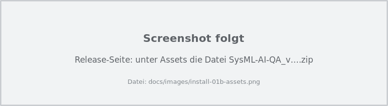

> **Nicht** *Source code (zip)* oder *Source code (tar.gz)* nehmen. Diese beiden Dateien hängt GitHub automatisch an. Darin ist nur der Quellcode ohne fertiges Plugin, und `install.bat` meldet dann *„fehlen Dateien“*.

### Schritt 2 – ZIP entpacken

Im Explorer **Rechtsklick auf die ZIP-Datei → Alle extrahieren… → Extrahieren**.

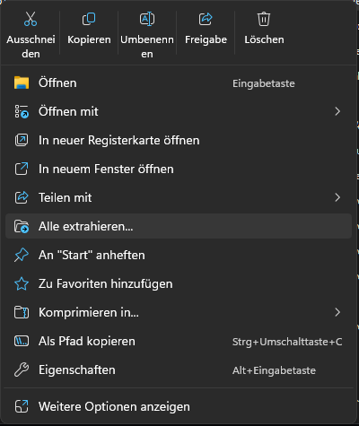

Es öffnet sich ein Ordner `SysML-AI-QA_v…`. Darin liegen unter anderem `install` (*Windows-Batchdatei*) und `install` (*Windows PowerShell-Skript*). Windows blendet die Endungen `.bat` und `.ps1` oft aus. Gestartet wird die **Windows-Batchdatei**.

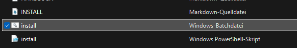

| Datei / Ordner | Inhalt |
| --- | --- |
| `install.bat` | startet die Installation |
| `install.ps1` | das eigentliche Installationsskript (wird von `install.bat` aufgerufen) |
| `plugin\` | das Plugin selbst: JAR, `plugin.xml`, Export-Vorlagen, System-Prompt |
| `INSTALL.md`, `HANDBUCH.md`, `docs\` | diese Anleitung und das Benutzerhandbuch mit Bildern |

> `install.bat` **nicht** direkt in der ZIP doppelklicken (Windows zeigt ZIP-Dateien wie Ordner an). Dann fehlen die anderen Dateien und das Skript meldet *„install.ps1 wurde nicht gefunden“*.

### Schritt 3 – CATIA schließen

CATIA komplett beenden, auch weitere geöffnete CATIA-Fenster. Solange CATIA läuft, ist die Plugin-Datei gesperrt.

### Schritt 4 – `install.bat` starten

Im entpackten Ordner **`install.bat` doppelklicken**.

**4a – Windows-Warnung.** Weil die Datei aus dem Internet kommt, warnt Windows meist: *„Der Herausgeber konnte nicht verifiziert werden. Möchten Sie diese Software ausführen?“* → **Ausführen** klicken. (Bei der Variante *„Der Computer wurde durch Windows geschützt“*: **Weitere Informationen** → **Trotzdem ausführen**.)

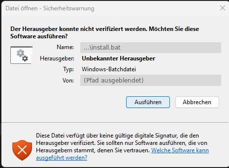

**4b – Administratorrechte.** Die Frage *„Möchten Sie zulassen, dass durch diese App Änderungen an Ihrem Gerät vorgenommen werden?“* (App: *Windows-Befehlsprozessor*) mit **Ja** beantworten. Achtung: Vorausgewählt ist *Nein*, also nicht einfach Enter drücken. Ohne Adminrechte kann das Plugin nicht in den CATIA-Ordner kopiert werden.

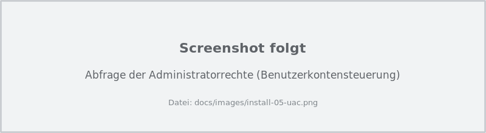

### Schritt 5 – Installation abwarten

Ein schwarzes Fenster öffnet sich und arbeitet vier Schritte ab:

| Schritt im Fenster | Was passiert |
| --- | --- |
| `1/4 CATIA-Installation suchen` | findet CATIA automatisch (meist `C:\Program Files\Magic Systems of Systems Architect`) |
| `2/4 Plugin-Ordner bestimmen` | *Neuinstallation* oder *Vorhandene Installation gefunden – sie wird aktualisiert* |
| `3/4 Ältere Version … entfernen` | nur bei einer sehr alten Version mit anderer Plugin-ID: Sie wird nach `Dokumente\SysML-AI-QA\backup\` verschoben. Sonst steht dort *Keine gefunden* |
| `4/4 Dateien kopieren` | kopiert das Plugin; eine vorhandene JAR wird als `.bak` gesichert |

Am Ende steht in Grün **„Fertig! SysML AI Q&A … ist installiert.“** Eine beliebige Taste drücken, das Fenster schließt sich.

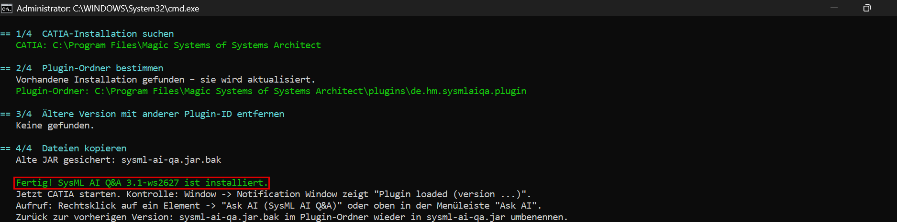

Steht dort stattdessen `FEHLER: …` in Rot, hilft die Tabelle [Wenn etwas nicht klappt](#wenn-etwas-nicht-klappt).

---

## Erster Start

### Schritt 6 – API-Key besorgen (einmalig)

Das Plugin braucht einen persönlichen Schlüssel für die Gemini-API von Google. Er ist im Free Tier kostenlos.

1. <https://aistudio.google.com/apikey> öffnen und mit dem Google-Konto anmelden.
2. Oben rechts **API-Schlüssel erstellen** klicken (englische Oberfläche: *Create API key*). Unter *Abrechnungsstufe* sollte **Kostenlose Stufe** stehen.
3. Den angezeigten Key **kopieren** (Strg+C). Der Key ist wie ein Passwort: nicht weitergeben und nicht auf Screenshots zeigen.

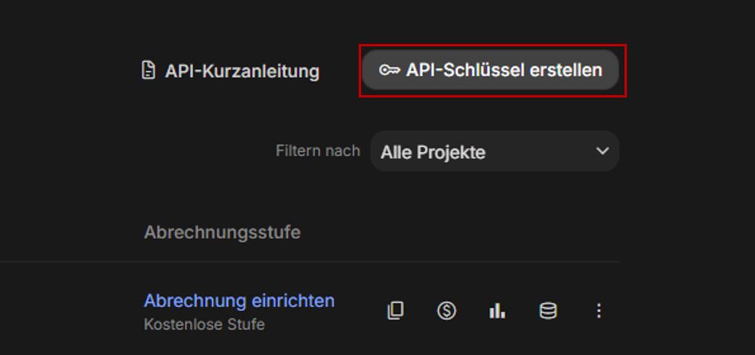

### Schritt 7 – CATIA starten und zwei Fragen beantworten

Beim **ersten Start von CATIA nach der Installation** erscheinen nacheinander zwei Fenster:

**Datenschutzhinweis:** Mit **Yes** zustimmen. Das Plugin schickt das Modell an Google. Deshalb nur Modelle ohne vertrauliche Inhalte verwenden.

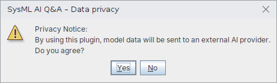

**API-Key:** Den kopierten Key einfügen (Strg+V) → **OK**. Er wird nur lokal auf diesem PC gespeichert.

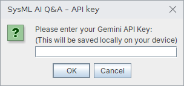

Wer hier *No* oder *Abbrechen* klickt, wird beim ersten Öffnen des Plugins noch einmal gefragt. Den Key kann man später jederzeit über **Ask AI → SysML AI Q&A – API key…** oder den Button **API key…** im Plugin-Fenster ändern.

> Wurde vorher schon eine ältere Version benutzt, entfallen beide Fragen: Zustimmung und Key werden übernommen.

### Schritt 8 – Prüfen, ob das Plugin geladen ist

In CATIA oben im Menü **Window → Notification Window** öffnen (oder **Strg+M**).

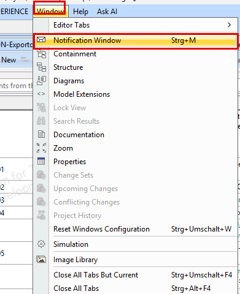

Im Notification Window muss eine Zeile stehen wie:

```
[SysML AI Q&A] Plugin loaded (version 3.1-ws2627, 17/17 diagram/table types)
```

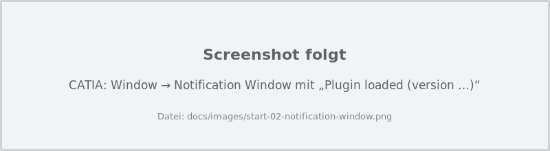

Fehlt die Zeile, ist das Plugin nicht geladen (siehe [Wenn etwas nicht klappt](#wenn-etwas-nicht-klappt)).

### Schritt 9 – Plugin öffnen

Ein Projekt öffnen. Dann gibt es zwei Wege:

**Rechtsklick** auf ein Element im Containment Tree oder in einem Diagramm → **Ask AI (SysML AI Q&A)** → **Ask AI…**. Im Fenster wählst du unter *Context*, ob das ganze Modell, ausgewählte Pakete oder nur dieses Element mit Umgebung an die KI geht, und klickst **Export model**.

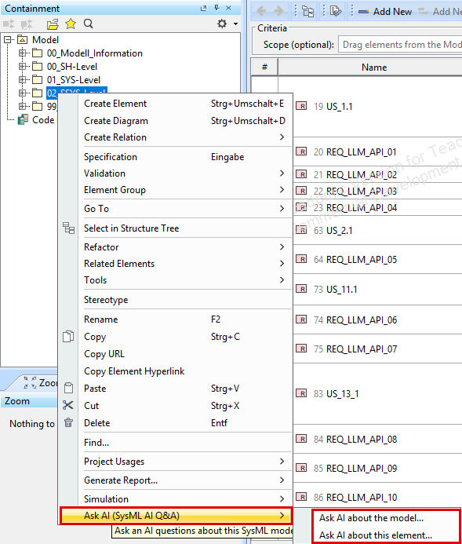

**Menüleiste:** ganz rechts **Ask AI** → *Ask AI…* oder *SysML AI Q&A – API key…*. Das funktioniert auch, wenn ein Element in einer Tabelle markiert ist.

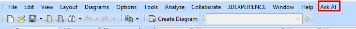

Es öffnet sich das Fenster **SysML AI Q&A**. Das Plugin exportiert zuerst das Modell. Sobald im Einstellungsbereich **Model ready: …** steht, kann man Fragen stellen.

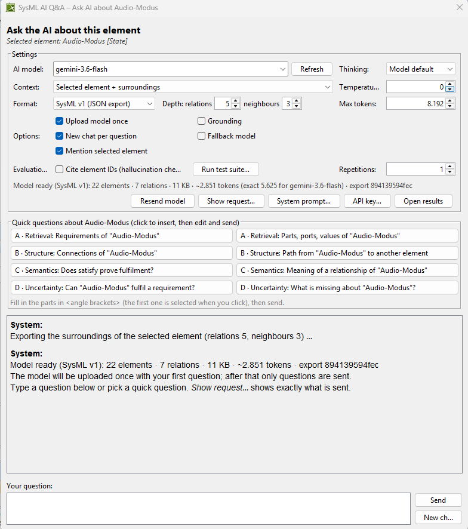

Wie es weitergeht und was jede Einstellung bedeutet, steht im **[Benutzerhandbuch](HANDBUCH.md)**.

---

## Weg B – Selbst bauen (Entwickler)

**Einmalig: Java JDK installieren**

1. *Eclipse Temurin JDK 21* (Windows, `.msi`) von <https://adoptium.net> herunterladen.
2. Bei der Installation den Punkt **Set JAVA_HOME variable** auf „Will be installed“ stellen.
3. Prüfen: Eingabeaufforderung öffnen und `javac -version` eingeben. Es muss **17 oder höher** erscheinen. Steht dort `1.8`, ist noch ein altes Java aktiv. Das Build-Skript sucht zwar selbst nach einem passenden JDK, mit JAVA_HOME klappt es aber sicherer.

**Bauen und installieren**

| Skript | Was es tut |
| --- | --- |
| `update.bat` | lädt den neuesten Stand des Branches `feature/free-prompt-full-model` von GitHub, baut ihn und installiert ihn. Legt außerdem das Paket für Weg A unter `dist\` ab. Ein Git-Clone ist dafür nicht nötig. |
| `build.bat` | baut den Code aus dem eigenen Ordner (für lokale Änderungen), legt das Paket unter `dist\` ab und installiert es |
| `install.bat` | installiert nur, ohne zu bauen (das ist der Weg A) |

Alle drei fragen selbst nach Administratorrechten. CATIA vorher schließen.

**Optionen**, falls die automatische Suche nicht klappt:

```
build.bat -CatiaDir "C:\Program Files\Magic Systems of Systems Architect"
build.bat -PluginDir "C:\Program Files\Magic Systems of Systems Architect\plugins\de.hm.sysmlaiqa.plugin"
build.bat -JdkDir "C:\Program Files\Eclipse Adoptium\jdk-21…"
build.bat -NoInstall        (nur bauen und Paket erstellen)
```

Dieselben Optionen funktionieren auch mit `update.bat`. Mit `install.bat` gehen `-CatiaDir` und `-PluginDir`.

---

## Neue Version an andere verteilen (Team)

Das macht GitHub automatisch: Bei jedem Push auf `main` oder `feature/free-prompt-full-model` baut GitHub das Plugin und veröffentlicht das Paket als neuestes Release (*Latest*). Neue Teammitglieder laden also immer den aktuellen Stand, ohne dass jemand bei sich etwas ausführen muss. Den Fortschritt sieht man im Repository unter **Actions** (grüner Haken = Release ist aktuell, dauert etwa 2 Minuten).

- **Neue Version:** `PLUGIN_VERSION` in `src/de/hm/sysmlaiqa/api/EvaluationRecord.java` erhöhen und in `AENDERUNGEN.md` einen Abschnitt `## v<Version> – …` ergänzen. Er wird der Text des Releases. Nach dem Push entsteht ein neues Release `v<Version>`.
- **Gleiche Version:** Das vorhandene Release bekommt die neu gebaute ZIP, der Tag wird auf den neuen Stand gesetzt.

### Wie GitHub ohne CATIA baut

GitHub hat kein CATIA. Im Ordner `ci/catia-stubs` liegen deshalb die Signaturen der CATIA-Klassen, die das Plugin verwendet (nur Namen von Klassen, Methoden und Konstanten, kein Programmcode von CATIA). Dagegen wird kompiliert; in CATIA läuft das Plugin dann mit den echten Klassen.

Die Signaturen muss man nur neu erzeugen, wenn der Code **CATIA-Klassen oder -Methoden verwendet, die bisher nicht vorkamen**. Dann schlägt der Build unter **Actions** rot fehl, GitHub schickt eine E-Mail, und das bisherige Release bleibt unverändert. So geht es:

1. Auf einem PC mit CATIA und Java JDK 17+ im Repository-Ordner `tools\update-catia-stubs.bat` doppelklicken (keine Adminrechte nötig, CATIA darf offen sein).
2. Das Skript kompiliert das Plugin gegen das echte CATIA und gegen die neuen Signaturen und vergleicht beide Ergebnisse. Am Ende steht *„Alle … Klassen des Plugins sind byte-gleich“*.
3. Den Ordner `ci/catia-stubs` committen und pushen (das Skript bietet das an, wenn Git installiert ist). Danach baut GitHub das Release.

Änderungen an Oberfläche, Prompts, Logik, Export-Vorlagen oder Dokumentation brauchen das nicht.

### Von Hand (falls nötig)

`update.bat` oder `build.bat` legen das Paket unter `dist\SysML-AI-QA_v<Version>.zip` ab.

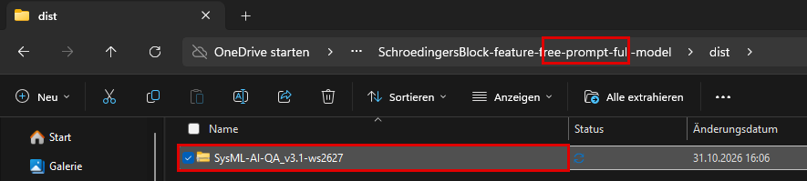

Auf GitHub: **Releases → Draft a new release** (bei einem vorhandenen Release: Release öffnen → **Stift-Symbol**), Tag `v<Version>`, ZIP in *Attach binaries by dropping them here* ziehen → **Publish release**.

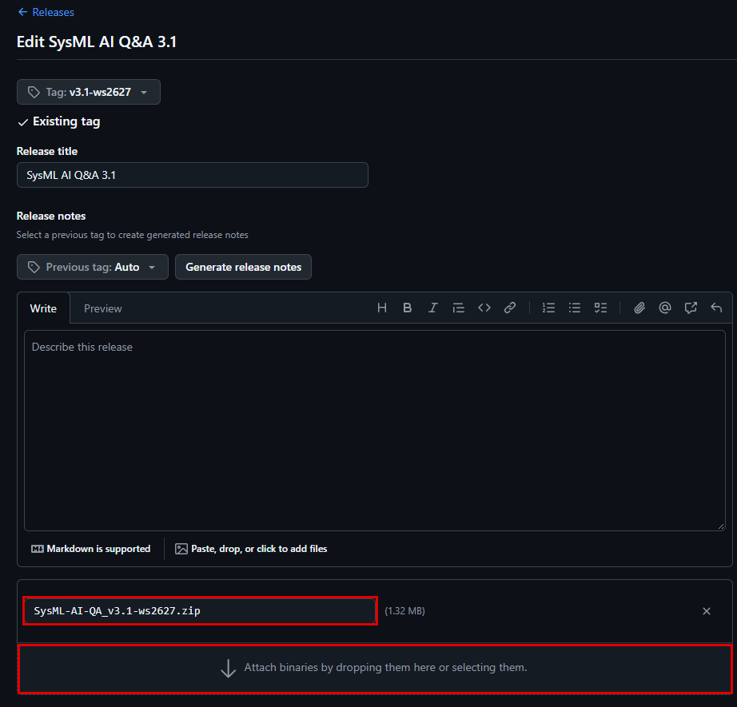

Die ZIP gehört **nicht** in den Code (sie steht in `.gitignore`). Sie wird nur als Release-Datei hochgeladen.

---

## Plugin aktualisieren (Update)

Eine neue Version installiert man über die bestehende alte. API-Key, Einstellungen und alle Ergebnisse unter `Dokumente\SysML-AI-QA\` bleiben erhalten.

### Variante 1 – mit `update.bat` (empfohlen, holt automatisch den neuesten Stand)

**Wo liegt `update.bat`?** In dem Ordner, in den du das Projekt (den Quellcode von GitHub) heruntergeladen und entpackt hast, also dort, wo auch `build.bat` und `install.bat` liegen. Wenn du ihn nicht mehr findest: im Explorer oben rechts nach `update.bat` suchen.

Es gibt zwei Dateien mit dem Namen *update*. Starte die mit dem Typ **Windows-Batchdatei** (Zahnrad-Symbol), nicht die PowerShell-Datei:

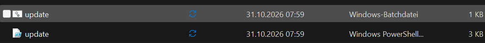

1. **CATIA komplett schließen.**
2. **`update.bat` doppelklicken** (Typ *Windows-Batchdatei*).
3. Die Frage nach Administratorrechten mit **Ja** beantworten (wie in [Schritt 4b](#schritt-4--installbat-starten)).
4. Abwarten: Das schwarze Fenster lädt den neuesten Stand von GitHub, baut das Plugin und installiert es (etwa 1–2 Minuten). Am Ende steht in Grün **„Fertig! … ist installiert.“**
5. **CATIA starten** und im **Window → Notification Window** prüfen, dass die neue Version geladen wurde: *„Plugin loaded (version …)“*.

Hinweise:

- `update.bat` braucht ein **Java JDK 17+** (siehe [Weg B](#weg-b--selbst-bauen-entwickler)), weil es das Plugin selbst baut. Ohne JDK die Variante 2 nehmen.
- Es ist egal, wie alt der Ordner mit `update.bat` ist: Der Code wird immer frisch von GitHub geladen, und die Skripte im Ordner werden dabei gleich mit aktualisiert.
- Meldet das Fenster, dass `System_Prompt.md` *von euch geändert* wurde und erhalten bleibt, ist das in Ordnung. Die neue Fassung liegt daneben als `System_Prompt.md.new`.

### Variante 2 – mit dem fertigen Paket (ohne Java)

Neue ZIP herunterladen (wie in [Schritt 1](#schritt-1--paket-herunterladen)), entpacken und `install.bat` starten. Das Paket enthält keine `update.bat`, ein Update ist hier also immer: neue ZIP + `install.bat`.

---

## Zurück zur alten Version, Deinstallation

- **Zurück zur vorherigen Version:** im Plugin-Ordner `sysml-ai-qa.jar` löschen und `sysml-ai-qa.jar.bak` in `sysml-ai-qa.jar` umbenennen.
- **Deinstallation:** CATIA schließen und den Ordner `<CATIA-Ordner>\plugins\de.hm.sysmlaiqa.plugin` löschen (braucht Adminrechte). Die Ergebnisse unter `Dokumente\SysML-AI-QA\` bleiben erhalten und können von Hand gelöscht werden.

Der Plugin-Ordner liegt normalerweise unter `C:\Program Files\Magic Systems of Systems Architect\plugins\de.hm.sysmlaiqa.plugin`. Das Installationsskript zeigt den genauen Pfad an.

---

## Wenn etwas nicht klappt

| Meldung / Beobachtung | Ursache | Lösung |
| --- | --- | --- |
| `install.ps1 wurde nicht gefunden` oder `fehlen Dateien` | ZIP nicht (vollständig) entpackt | Rechtsklick auf die ZIP → **Alle extrahieren**, dann im entpackten Ordner starten |
| `CATIA wurde nicht automatisch gefunden` | CATIA liegt an einem ungewöhnlichen Ort | Startmenü → Rechtsklick auf CATIA → **Dateispeicherort öffnen** → nochmal Rechtsklick auf die Verknüpfung → **Dateispeicherort öffnen** → eine Ebene hoch. Diesen Ordner (mit `bin`, `lib`, `plugins`) ins Fenster einfügen |
| `Keine Schreibrechte` / `Zugriff verweigert` | ohne Adminrechte gestartet oder CATIA läuft noch | CATIA schließen; Rechtsklick auf die `.bat` → **Als Administrator ausführen** |
| `CATIA läuft noch` | ein CATIA-Fenster ist noch offen | alle CATIA-Fenster schließen, ggf. im Task-Manager beenden, dann Enter |
| Nach dem Start kein Menüeintrag „Ask AI“ | Plugin in eine andere CATIA-Installation kopiert oder Ladefehler | Pfad aus dem Installationsfenster mit dem CATIA-Startpfad vergleichen; im Notification Window nach `SysML AI Q&A` suchen und die Meldung ans Team schicken |
| Rechtsklick in einer **Requirement-Tabelle** zeigt keinen Eintrag | bekannte Einschränkung | Zeile markieren und oben in der Menüleiste **Ask AI → Ask AI about the selected element…** wählen, oder **Alt+B** (Select in Containment Tree) und dort Rechtsklick |
| `HTTP 429` | Free-Tier-Limit erreicht | Minutenlimit: das Plugin wartet selbst. Tageslimit: bis morgen warten oder ein anderes KI-Modell wählen |
| `HTTP 503` / `HTTP 500` | Google-Server überlastet | wird automatisch bis zu dreimal wiederholt; sonst später erneut versuchen oder ein anderes Modell wählen |
| `HTTP 400` / `HTTP 403` mit „API key“ | API-Key falsch oder gelöscht | über **API key…** einen neuen Key eintragen |
| (Weg B) `Kein Java JDK` oder `javac 1.8` | kein oder zu altes JDK | Temurin JDK 21 installieren (siehe oben) |

Hilft das nicht: den Text aus dem schwarzen Fenster bzw. aus **Window → Notification Window** kopieren und an das Team schicken.
